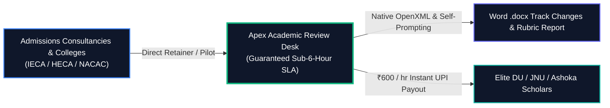

# 🕵️ ThinkingStorm Competitive Teardown & Disintermediation Architecture

**Document Version:** `1.0.0`  
**Target Competitor:** ThinkingStorm Inc. (`thinkingstorm.com`) $\leftrightarrow$ Trivium Education Services India Back-End  
**Date:** `2026-10-24`  
**Purpose:** Comprehensive endpoint traversal, product gap analysis, and commercial disintermediation strategy.

---

## 🏛️ 1. ThinkingStorm Architecture & Traversed Endpoints

Our automated probe of `thinkingstorm.com` revealed a legacy ASP.NET WebForms stack with dated telemetry:

```
Platform Architecture: ASP.NET WebForms (ViewState & EventValidation)
Legacy Telemetry     : Urchin Tracker (UA-826297-3) & Sunset Universal Analytics
Primary Portals      : thinkingstorm.com, tutor.thinkingstorm.com, LMS LTI 1.1/1.3 SSO
```

### Traversed Public Endpoints:
| Route | Function | Vulnerability / Legacy Bottleneck |
| :--- | :--- | :--- |
| `/default.aspx` | Main Marketing Portal | Outdated UI; lacks interactive live diagnostic tools. |
| `/highereducation.aspx` | Institutional College Pitch | Focused on remedial retention, not competitive admissions. |
| `/institutionalregistration.aspx` | Institutional Intake Form | Slow sales cycle; requires multi-week manual RFP process. |
| `/products.aspx` | Program Matrix | "AnytimeAnswers" ($99/mo) & "Writing Center" ($19–$35/hr). |
| `/billing-policy.aspx` | Hourly BPO Invoicing | 15-minute incremental billing; unpredictable institutional costs. |
| `/login.aspx` | WebForms Member Portal | Session timeouts; requires institutional LMS SSO integration. |
| `/sitemap.xml` | XML Index (9 routes) | Minimal public feature visibility; no public API documentation. |

---

## ⚡ 2. The Legacy Outsourcing Arbitrage (ThinkingStorm $\leftrightarrow$ Trivium)


* **The Problem for Clients:** Turnaround takes **24 to 48 hours**. During October–January application deadlines, a 48-hour delay causes missed deadlines and frantic counselor all-nighters.
* **The Problem for Reviewers:** Indian academic specialists earn low sweatshop wages (₹150–200/hr) for grueling night shifts, causing high turnover and inconsistent quality.
* **The Product Defect:** Feedback is typically delivered as flat marginal text comments or converted PDFs rather than interactive, native Word OpenXML track changes.

---

## 🚀 3. How Apex Disintermediates ThinkingStorm



### Feature-by-Feature Competitive Matrix:

| Feature Dimension | ThinkingStorm Writing Center | Apex Academic Review Desk | Apex Advantage |
| :--- | :--- | :--- | :--- |
| **Turnaround Time (SLA)** | 24 to 48 Hours (~18h avg) | **Guaranteed Sub-6-Hour SLA** (4.2h avg) | **4x Faster** (critical for EA/ED deadlines) |
| **Deliverable Technology** | Flat comments / PDF exports | **Native OpenXML `<w:ins>` & `<w:del>`** | Counselors click **Accept/Reject** directly in Word |
| **Editorial Rubric** | Generic remedial college grammar | **4-Pillar Elite Admissions Rubric** | Specifically targets hooks, voice, and clichés |
| **Ethics & Compliance** | General tutoring disclaimer | **IECA & FERPA Cryptographic Attestation** | Guarantees authentic voice; zero ghostwriting |
| **Self-Prompting Productization**| Static prompts / manual grading | **Self-Prompting Closed-Loop Critic** | Mathematically converges on $\ge 91/100$ quality |
| **Institutional Pricing** | $30–$45/hr or complex billing | **$150 5-Draft Pilot / $1.5k–$2.5k Retainer** | Transparent, predictable capacity pricing |
| **Reviewer Compensation** | ₹150–₹200/hr (BPO sweatshop) | **₹600/hr with Instant UPI Settlement** | **3x Higher Pay** attracts India's top academic minds |

---

## 🎯 4. Strategic Actions for Product Superiority

1. **Highlight the 48h vs 6h SLA Contrast:** Every pitch and landing page section contrasts ThinkingStorm's slow 48-hour queue against Apex's 6-hour guarantee.
2. **Promote the OpenXML Advantage:** Show admissions counselors that our deliverables require zero copy-pasting—they open directly in Microsoft Word with clickable change tracking.
3. **Offer Direct B2B Retainers:** Use our Institutional Invoicing console (`/admin/invoices`) to issue formal agreements that bypass ThinkingStorm's bureaucratic RFP delays.
