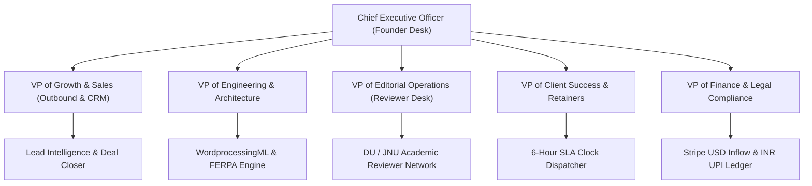

# 🏛️ Apex Academic Review Desk Inc. — Corporate Governance & Departmental Charter

> **Mission:** Disintermediate legacy academic review BPOs (ThinkingStorm US $\leftrightarrow$ Trivium India back-end). Provide high-margin direct overflow review capacity to 1,000+ US & International admissions consultancies (IECA/HECA/NACAC) with guaranteed sub-6-hour SLA, native Word OpenXML track changes, and 100% authentic student voice preservation.

---

## 🏢 Executive Leadership & Division Matrix (Paperclip Delegation Protocol)

---

## 1. Growth & Enterprise Sales Division
* **Head:** VP of Growth (`growth-vp`)
* **Primary Charter:** Aggressive customer acquisition across North American, European, and Asian admissions consulting practices.
* **Core KPIs:**
  * Weekly New CRM Outreaches: $\ge 50$ firms
  * Paid Pilot Conversion Rate: $\ge 20\%$
  * Pilot $\to$ Retainer Conversion Rate: $\ge 35\%$
  * Target MRR: **$50,000.00 USD / month** by Jan 1, 2027
* **Delegation Directives:**
  * Ingest verified IECA/HECA directory firms.
  * Execute tailored email pitches anchored on November 1 Early Decision deadlines.
  * Run automated objection handling on non-ghostwriting ethics and rapid 6h turnaround.

---

## 2. Engineering & Infrastructure Division
* **Head:** VP of Engineering (`eng-lead`)
* **Primary Charter:** 24/7 server reliability, Word OpenXML track changes fidelity, edge tunnel routing, and machine learning diagnostic engines.
* **Core KPIs:**
  * Uptime SLA: **99.9%** across Cloudflare Edge & FastAPI Core
  * Track Changes Accuracy: 100% native `<w:ins>` / `<w:del>` markup (zero formatting corruption)
  * Audit Latency: $\le 0.4$ seconds on sample essay audits
  * Anti-Sleep Uptime: Zero system suspend events during active queues
* **Delegation Directives:**
  * Maintain detached host execution via `apex_service_monitor.py`.
  * Ensure FERPA PII scrubbing operates ahead of reviewer claim queues.
  * Supervise continuous integration and regression testing.

---

## 3. Academic Editorial & Talent Operations Division
* **Head:** VP of Editorial Operations (`editorial-lead`)
* **Primary Charter:** Recruiting, onboarding, qualifying, and managing India's top academic writing specialists (ex-Trivium, Delhi University, JNU, Ashoka University).
* **Core KPIs:**
  * Active Vetted Reviewer Pool: $\ge 25$ qualified editors
  * Review Quality Index: $\ge 95/100$ on 4-pillar rubric alignment
  * Turnaround Time: Average reviewer completion in $\le 4.2$ hours
  * Reviewer Satisfaction: Instant UPI payouts within 2 hours of approval
* **Delegation Directives:**
  * Administer `/reviewer/qualify` exam.
  * Maintain zero tolerance for text generation or ghostwriting.
  * Balance capacity to prevent reviewer fatigue during crunch weeks.

---

## 4. Client Success & Retainer Management Division
* **Head:** VP of Client Success (`success-lead`)
* **Primary Charter:** Maximize lifetime value (LTV) and guarantee flawless delivery for admissions directors during peak application deadlines.
* **Core KPIs:**
  * SLA Breach Rate: **0.0%** (Sub-6-hour guarantee strictly met)
  * Retainer Churn: $< 5\%$ monthly
  * Net Promoter Score (NPS): $\ge 75$
* **Delegation Directives:**
  * Monitor live countdown clocks on `/agency/dashboard`.
  * Send immediate SMS/WhatsApp notification upon draft completion.
  * Deliver verified Certificates of Institutional Authenticity.

---

## 5. Finance & Compliance Division
* **Head:** VP of Finance (`finance-lead`)
* **Primary Charter:** Oversee unit economics, gross margins, cross-border currency flows ($ USD inflow $\to$ ₹ INR outflow), and institutional contract compliance.
* **Core KPIs:**
  * Gross Margin: $\ge 88\%$
  * AR / Days Sales Outstanding: $\le 7$ days
  * FERPA & IECA Ethical Compliance: 100% clean audit log
* **Delegation Directives:**
  * Reconcile Stripe and ACH receipts with database transactions.
  * Manage UPI disbursement ledger for Indian freelancer community.
  * Maintain tamper-proof cryptographic audit trail.
