# 🏢 Apex Academic Review Desk Inc. — Corporate Org Chart & Paperclip Delegation Tree

**Document Version:** `2.0.0`  
**Operating Model:** Autonomous Agentic Corporation (Founder-Led Executive Hierarchy with Paperclip Role Delegation).

---

## 🌲 Organizational Hierarchy

```mermaid
graph TD
    FOUNDER["Shashank Mahajan<br/>Founder & CEO"]
    
    subgraph Growth_Division["1. Growth & Sales Division"]
        VP_GROWTH["VP of Growth"]
        AGENT_SCOUT["Paperclip Subagent: outbound-scout<br/>(Directory Scraper & Lead Enrichment)"]
        AGENT_PITCH["Paperclip Subagent: sales-closer<br/>(Objection Handling & Retainer Pitching)"]
        VP_GROWTH --> AGENT_SCOUT
        VP_GROWTH --> AGENT_PITCH
    end

    subgraph Editorial_Division["2. Academic Editorial Operations"]
        VP_EDITORIAL["VP of Editorial Operations"]
        AGENT_RECRUIT["Paperclip Subagent: reviewer-assessor<br/>(DU/JNU Onboarding & Test Grading)"]
        AGENT_ALLOC["Paperclip Subagent: queue-dispatcher<br/>(SLA Load Balancing & Subject Matching)"]
        VP_EDITORIAL --> AGENT_RECRUIT
        VP_EDITORIAL --> AGENT_ALLOC
    end

    subgraph Engineering_Division["3. Engineering & Systems Architecture"]
        VP_ENG["VP of Engineering"]
        AGENT_DOCX["Paperclip Subagent: openxml-architect<br/>(WordprocessingML Track Changes Engine)"]
        AGENT_OPS["Paperclip Subagent: devops-watchdog<br/>(Win32 Anti-Sleep & Cloudflare Tunnel)"]
        VP_ENG --> AGENT_DOCX
        VP_ENG --> AGENT_OPS
    end

    subgraph Success_Division["4. Client Success & Account Management"]
        VP_SUCCESS["VP of Client Success"]
        AGENT_ONBOARD["Paperclip Subagent: client-concierge<br/>(Intake Onboarding & Counselor Briefing)"]
        AGENT_SLA["Paperclip Subagent: sla-guardian<br/>(Sub-6-Hour Delivery Guarantee & Alerts)"]
        VP_SUCCESS --> AGENT_ONBOARD
        VP_SUCCESS --> AGENT_SLA
    end

    subgraph Finance_Division["5. Finance, Legal & Treasury"]
        VP_FINANCE["VP of Finance & Legal"]
        AGENT_STRIPE["Paperclip Subagent: stripe-auditor<br/>(USD Inflow Reconciler & Invoicing)"]
        AGENT_UPI["Paperclip Subagent: upi-treasurer<br/>(Instant INR Payout Ledger & FERPA Logs)"]
        VP_FINANCE --> AGENT_STRIPE
        VP_FINANCE --> AGENT_UPI
    end

    FOUNDER --> VP_GROWTH
    FOUNDER --> VP_EDITORIAL
    FOUNDER --> VP_ENG
    FOUNDER --> VP_SUCCESS
    FOUNDER --> VP_FINANCE
```

---

## 📋 Division Mandates & Accountability Matrix

| Role / Subagent | Key Delegation Responsibilities | Target KPI | Tool / File Authority |
| :--- | :--- | :--- | :--- |
| **Founder & CEO** | Strategic capital allocation, cross-department synthesis, institutional partnership approvals | High-margin ARR, 0% SLA breach | All Executive Dashboards, Git Master |
| **`outbound-scout`** | Directory enrichment (IECA, HECA, NACAC, international school counselors), lead deduplication | 50+ new leads/week, verified emails | `crm_leads` SQLite table, `outbound/` |
| **`sales-closer`** | Outbound messaging, objection mitigation on AI/voice authenticity, pilot booking | $\ge 20\%$ pilot rate, $\ge 35\%$ retainer conversion | `payments/stripe_gateway.py`, `/checkout` |
| **`reviewer-assessor`** | Indian reviewer candidate screening (DU/JNU alumni), qualifying essay assessments | Reviewer bench $\ge 25$ scholars, quality score $\ge 95$ | `/reviewer/qualify`, `rubric_evaluator.py` |
| **`queue-dispatcher`** | Routing incoming submissions to best-fit subject reviewer, managing SLA clocks | Time-to-claim $\le 15$ min, turnaround $\le 4.5$ h | `/reviewer` workbench, `/agency/dashboard` |
| **`openxml-architect`** | Native OpenXML `<w:ins>`, `<w:del>` markup validation, FERPA sanitization | 100% native Word change-tracking, 0 corruption | `engine/openxml_track_changes.py` |
| **`devops-watchdog`** | Win32 host execution state (`ES_SYSTEM_REQUIRED`), Cloudflare tunnel, poller daemon | 99.9% uptime, 0 sleep interruptions | `orchestrator/apex_service_monitor.py` |
| **`sla-guardian`** | Countdown monitor, counselor notification, delivery verification certificate hashing | 0 breaches against 6h clock, 100% certificate generation | `output/*.docx`, `submissions` table |
| **`upi-treasurer`** | Reconciling USD client inflows against INR UPI reviewer disbursements, 88%+ margin preservation | P&L accuracy, instantaneous reviewer UPI payout | `transactions`, `reviewer_earnings` |
