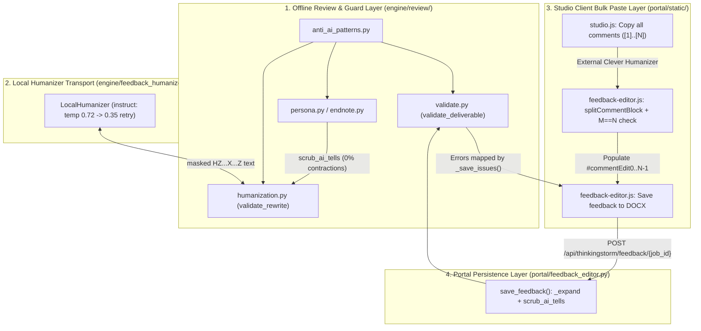

# Anti-AI Feedback Humanization & Studio Bulk Paste Workflow

*   **Author:** Shashank / Antigravity
*   **Status:** Draft
*   **Date:** 2026-10-27

--------------------------------------------------------------------------------

## Overview

ThinkingStorm reviewers deliver feedback to students inside native Word `.docx` files through margin comments (`word/comments.xml`) and a closing endnote letter (`word/endnotes.xml`). Reviewers and quality auditors evaluate these deliverables against external AI detectors—specifically `gptzero.com` and Clever AI Humanizer's detector—where a 0% AI detection reading is required before delivery.

This design eliminates AI-detector triggers across both automated generation (`engine/review/` and `engine/feedback_humanizer.py`) and the manual Clever AI Humanizer round-trip in Studio (`portal/static/feedback-editor.js`, `portal/static/studio.js`, and `portal/static/studio.html`). It keeps the portal HTML/JSON summary report (`engine/review/report.py`) out of scope and preserves all native Word package invariants.

## The Problem

Current deliverables trigger AI detectors and introduce manual editing friction for four reasons:

1.  **Low-Perplexity Local Humanizer Sampling and Over-Rejection**: When `LocalHumanizer` runs in `instruct` mode (`qwen3.5:9b`), `engine/feedback_humanizer.py` uses `temperature=0.4` and `top_p=0.9`, forcing high-probability token selection that detectors flag as machine-generated. At the same time, `validate_rewrite()` in `engine/review/humanization.py` requires exact word-count equality across all 11 modal and conditional words (`not, no, never, without, cannot, may, might, could, likely, possibly, if, unless`). When the model recasts a conditional sentence into a direct imperative, `validate_rewrite()` rejects the rewrite and retains the original template prose (rejecting 13 of 39 passages in saved benchmarks).
2.  **Inconsistent Contraction and Quote-Masking Rules**: `scrub_ai_tells()` in `engine/review/anti_ai_patterns.py` injects contractions (`don't`, `isn't`, `can't`, `you'll`, `it's`) at a 70% rate, even though the human reviewer corpus (`style_corpus/voice_profile.json`) has a 0% contraction rate and `engine/review/humanization.py` expands all contractions back to full forms (`_expand()`). Additionally, single-quote masking in `anti_ai_patterns.py` stops at the first typographic apostrophe `’` inside single-quoted student excerpts in endnotes, leaving student prose unmasked during AI-tell checks.
3.  **Unmapped Release Gate Errors on Studio Save**: `validate_deliverable()` in `engine/review/validate.py` checks `banned_hits()` but does not enforce `audit_ai_tells()`. Furthermore, `_save_issues()` in `portal/feedback_editor.py` maps unrecognized comment errors to a generic `"failed a Word integrity check"` message, misleading reviewers when a wording issue blocks a save.
4.  **Manual Field-by-Field Copy-Paste Friction in Studio**: Studio provides a one-click "Copy all comments" button so reviewers can paste the entire batch of 10–20 comments into Clever AI Humanizer. However, once Clever rewrites the block, the reviewer must manually copy and paste each comment back into 10–20 separate textareas (`#commentEdit0` through `#commentEdit{N-1}`) before clicking "Save feedback to DOCX". If a naive bulk paste were used without a strict count check, merged or split paragraphs from Clever would shift comment bodies onto the wrong student quotes in `word/document.xml`.

## Goals

*   **Zero Structural AI Tells at Release Gate**: Ensure 100% of generated and Studio-saved margin comments (`word/comments.xml`) and closing letters (`word/endnotes.xml`) pass both `banned_hits() == []` and `audit_ai_tells() == []` in `engine/review/validate.py`.
*   **Consistent 0% Contraction Register**: Align `engine/review/anti_ai_patterns.py`, `engine/review/humanization.py`, `vendor/humanizer/editor_prompt.txt`, and `portal/feedback_editor.py` on the human reviewer corpus's 0% contraction standard outside quoted student spans.
*   **Higher Rewrite Acceptance and Token Diversity in Local Humanizer**: Increase `instruct` provider sampling diversity (`temperature=0.72, top_p=0.92` on attempt 1, falling back to `temperature=0.35, top_p=0.90` on retry) and relax `validate_rewrite()` modal/conditional matching on imperative recasts while preserving negation polarity (`not, no, never, without, cannot`), `only if` / `unless` conditions, and declarative uncertainty.
*   **One-Click Studio Bulk Paste with Anchor-Alignment Protection**: Provide a client-side "Paste / Apply all comments" workflow in Studio (`portal/static/feedback-editor.js`, `portal/static/studio.js`, `portal/static/studio.html`) that parses numbered or paragraph-separated comment blocks, enforces an all-or-nothing count check ($M == N$), populates `#commentEdit0..N-1`, and triggers `.docx` persistence.

## Non-Goals

*   Humanizing or modifying Studio HTML/JSON report summary fields (`executive_summary`, `top_action_items`, or rubric `rationale` in `engine/review/report.py` and `engine/processor.py`).
*   Making outbound network requests to `gptzero.com` or `cleverhumanizer.ai` from Python backend code (`engine/review/` remains 100% offline).
*   Modifying `portal/static/clever-widget.js` to manage editor state or cross-origin DOM scraping.
*   Regenerating `.docx` test fixtures in `tests/fixtures/` or mutating `style_corpus/voice_corpus.json`.

## Open Questions

*   None. All scope, contraction, qualifier-guard, and bulk-paste alignment decisions were resolved during the brainstorm review.

## Critical User Journeys (CUJs)

### CUJ 1: Automated Review with Guarded Local Humanizer

*   **Given**: A student `.docx` manuscript is submitted through the CLI or Studio with `backend=rules` and the local `instruct` humanizer enabled (`TS_HUMANIZER=local`).
*   **When**: Offline composition generates margin comments and the closing endnote, and `humanize_review()` rewrites each passage through `LocalHumanizer` and `validate_rewrite()`.
*   **Then**:
    *   `LocalHumanizer` samples the `instruct` endpoint at `temperature=0.72, top_p=0.92` on the first attempt and `temperature=0.35, top_p=0.90` on retry.
    *   `validate_rewrite()` preserves all protected `HZ<nonce>X<idx>Z` facts, negation counts (`not, no, never, without, cannot`), and `only if` / `unless` conditionals while accepting natural modal recasts on imperative advice, then applies `scrub_ai_tells()` (with 0% contractions) and verifies `audit_ai_tells() == []`.
    *   `validate_deliverable()` confirms zero banned phrases and zero AI tells before writing the final `.docx`.

### CUJ 2: Studio Clever AI Humanizer Bulk Copy, Paste & Save to DOCX

*   **Given**: A completed review is loaded in Studio with $N$ native Word margin comments and 1 closing endnote letter.
*   **When**:
    1.  The reviewer clicks **Copy all comments** (which formats the $N$ comments with `[1]`..`[N]` prefixes), humanizes the block in Clever AI Humanizer, and pastes the rewritten block into Studio's bulk comment paste box.
    2.  The reviewer clicks **Apply & save comments to DOCX**.
*   **Then**:
    *   If the pasted text splits into $M \neq N$ comment blocks, `FeedbackEditor` aborts before altering any `#commentEdit{i}` field and displays an error in `#feedbackSaveErrors` stating both $M$ and $N$.
    *   If $M == N$, `FeedbackEditor` strips leading numbering markers, populates `#commentEdit0` through `#commentEdit{N-1}`, and invokes `POST /api/thinkingstorm/feedback/{job_id}`.
    *   `portal/feedback_editor.py` normalizes each comment and endnote paragraph through `_expand()` and `scrub_ai_tells()`, validates the rebuilt `.docx` via `validate_deliverable()`, and atomically updates the downloadable `.docx` (or highlights the specific field if any comment violates length or tell checks).

## Technical Plan (Architecture)

The architecture is partitioned into four layers so that offline review generation (`engine/review/`), local model transport (`engine/feedback_humanizer.py`), portal persistence (`portal/feedback_editor.py`), and Studio UI state (`portal/static/feedback-editor.js`) remain decoupled.

### 1. Offline Anti-AI Scrubber & Quote Protection (`engine/review/anti_ai_patterns.py`)

*   **Apostrophe-Safe Quote Masking**: Single-quoted student spans (`‘...’` and `'...'`) are masked without terminating at word-internal apostrophes (`today’s`, `author's`), ensuring student prose is never mutated by `scrub_ai_tells()` or flagged by `audit_ai_tells()`.
*   **0% Contraction Standard**: `scrub_ai_tells()` rewrites all 26 structural and lexical AI tells deterministically without injecting contractions, keeping offline composition aligned with the human reviewer corpus.

### 2. Guarded Rewrite Validation & Local Humanizer Sampling (`engine/review/humanization.py`, `engine/feedback_humanizer.py`, `vendor/humanizer/editor_prompt.txt`)

*   **Targeted Qualifier Guard**: `validate_rewrite()` separates strict negation tokens (`not, no, never, without, cannot`) from strict conditional guards (`only if, unless`) and declarative uncertainty (`may, might, could, likely, possibly`). Imperative revision instructions can drop modal verbs naturally, whereas declarative observations must keep their uncertainty markers. Every validated rewrite passes through `scrub_ai_tells()` and `audit_ai_tells()`.
*   **Adaptive Sampling**: In `LocalHumanizer`, the `instruct` provider uses higher-entropy sampling (`temperature=0.72, top_p=0.92`) on the first attempt and falls back to conservative decoding (`temperature=0.35, top_p=0.90`) on retry, without penalizing `HZ<nonce>X<idx>Z` placeholder tokens. The `completion` provider remains unchanged.

### 3. Release Gate Enforcement & Save Normalization (`engine/review/validate.py`, `portal/feedback_editor.py`)

*   **Release Gate**: `validate_deliverable()` checks `audit_ai_tells()` alongside `banned_hits()` on every margin comment and endnote.
*   **Save Normalization**: `portal/feedback_editor.py` expands contractions outside quoted spans and runs `scrub_ai_tells()` on submitted comments and narrative endnote paragraphs before validating and writing the `.docx`, mapping any surviving tell to a field-linked diagnostic in `_save_issues()`.

### 4. Studio Client-Side Bulk Paste (`portal/static/feedback-editor.js`, `portal/static/studio.js`, `portal/static/studio.html`)

*   **Numbered Copy & Multi-Stage Parse**: Studio formats copied comment batches with 1-based bracketed numbers (`[1]`..`[N]`). On bulk paste, `FeedbackEditor.splitCommentBlock()` splits by sequential `1..N` markers first, then by blank lines, and finally by single lines if blank lines were collapsed.
*   **All-or-Nothing Count Gate**: If the split count $M$ does not match the native comment count $N$, `FeedbackEditor` rejects the paste before touching any `#commentEdit{i}` field. When $M == N$, it populates all comment fields and invokes the existing `Save feedback to DOCX` workflow.

## Alternatives Considered

### Alternative A: Injecting Contractions (`don't`, `isn't`, `can't`) to Lower AI Detector Scores

*   **Pros**: Increases token entropy on short declarative sentences in some general-purpose AI detectors.
*   **Cons**: Violates the measured 0% contraction rate across all 307 real reviewer comments in `style_corpus/voice_profile.json` and `docs/ANTI_AI_PRACTICES.md`, conflicts with `_expand()` in `engine/review/humanization.py` and `vendor/humanizer/editor_prompt.txt`, and breaks `test_no_contractions_are_added_to_prose_or_expanded_inside_quotes`.
*   **Reason for Rejection**: The human baseline corpus uses zero contractions. Enforcing 0% contractions across all modules keeps the reviewer register authentic and eliminates contradictory expand/contract passes between `anti_ai_patterns.py` and `humanization.py`.

### Alternative B: Runtime Grafting of Raw Sentences from `style_corpus/voice_corpus.json`

*   **Pros**: Uses verbatim human sentences from past reviews without writing new template frames.
*   **Cons**: `style_corpus/voice_corpus.json` (402 KB) contains essay-specific proper nouns (`"Lose Yourself"`, `"Eye of the Tiger"`, student names), occasional reviewer typos/double spaces, and praise-only comments. Grafting raw strings at runtime leaks unrelated facts into student drafts and breaks `validate_deliverable()` word-count and double-space checks.
*   **Reason for Rejection**: Offline composition must only use curated, document-neutral clause rhythm frames that bind to the current student's text and findings.

### Alternative C: High Repeat Penalty (`repeat_penalty=1.12`) and Dropping All Modal/Conditional Checks in `validate_rewrite()`

*   **Pros**: Forces maximum lexical variation from the local `instruct` model and minimizes rejected rewrites.
*   **Cons**: A `repeat_penalty` of `1.12` penalizes repeated `HZ<nonce>X<idx>Z` fact placeholder prefixes and plain academic nouns (`paragraph`, `thesis`, `source`), causing placeholder corruption and spiking retries against the 180-second session budget. Dropping all modal/conditional checks allows hedged observations (*"This claim may need support..."* or *"change it only if..."*) to become false factual assertions.
*   **Reason for Rejection**: Using `temperature=0.72, top_p=0.92` without `repeat_penalty` (and falling back to `0.35` on retry) increases token variety without corrupting `HZ...X...Z` placeholders, while targeted qualifier guards preserve `only if`/`unless` conditionals and declarative uncertainty.

### Alternative D: Adding Bulk-Paste State Management Inside `portal/static/clever-widget.js` or a New Backend Endpoint

*   **Pros**: Places the bulk paste UI directly inside the Clever widget script or offloads string splitting to Python.
*   **Cons**: Couples the 44-line detector-only `clever-widget.js` to `FeedbackEditor`'s internal dirty/error/save state machine, creating two competing controllers over `#commentEdit0..N-1`. A separate backend endpoint duplicates `POST /api/thinkingstorm/feedback/{job_id}`, which already accepts the full array of comments atomically.
*   **Reason for Rejection**: Keeping `splitCommentBlock()` and the $M == N$ count guard inside `portal/static/feedback-editor.js` preserves a single state owner and reuses the existing atomic save endpoint.

--------------------------------------------------------------------------------

## Non-Functional Requirements

*   **Air-Gapped Determinism (`engine/review/`)**: All functions in `engine/review/` (`anti_ai_patterns.py`, `persona.py`, `endnote.py`, `humanization.py`, `validate.py`) must remain 100% offline with zero network calls or external API dependencies.
*   **Latency & Session Budget (`engine/feedback_humanizer.py`)**: `LocalHumanizer` must stay within its 180-second total session wall-clock deadline and 30-second per-call timeout (`output/humanizer/review.lock`), using conservative `temperature=0.35` on retry so rejected candidates do not exhaust the budget.
*   **Native Word Integrity & Anchor Safety**: Bulk paste in Studio must never add, remove, or reorder native Word comment IDs (`w:id`) or modify `word/document.xml`. If parsed comment count $M$ does not equal native comment count $N$, zero fields are modified.
*   **Backward Compatibility with Headless Node Tests**: New DOM controls in `portal/static/feedback-editor.js` and `portal/static/studio.js` must use optional chaining (`?.`) so existing minimal-DOM unit tests in `tests/test_feedback_editor_js.py`, `tests/test_clever_widget.py`, and `tests/test_studio_js.py` pass without breaking.

--------------------------------------------------------------------------------

### Additional Resources

*   Reviewer voice and anti-detection baseline: [`../ANTI_AI_PRACTICES.md`](../ANTI_AI_PRACTICES.md)
*   Local feedback humanizer specification: [`./feedback-humanizer.md`](./feedback-humanizer.md)
*   Studio feedback editor specification: [`./studio-feedback-editing.md`](./studio-feedback-editing.md)
*   Stylometric anti-AI gate specification: [`./stylometric-anti-ai-gate.md`](./stylometric-anti-ai-gate.md)

--------------------------------------------------------------------------------

## Detailed Implementation Plan

### Target Files to Create/Modify

#### 1. [`engine/review/anti_ai_patterns.py`](../../engine/review/anti_ai_patterns.py) (Modify)

*   **Type / Scope**: Python Offline Stylometric Scrubber & Auditor Module
*   **Proposed Changes**:
    *   Update `_TYPO_SINGLE_QUOTE_PATTERN` to match `‘(?:[^’]|(?<=\w)’(?=\w))*’` and add straight single-quote protection `(?<!\w)'(?:[^'\n]|(?<=\w)'(?=\w))*'(?!\w)` inside `_mask_protected_spans()` so word-internal apostrophes (`today’s`, `author's`) inside single-quoted student excerpts do not terminate quote masking early.
    *   Remove `_CONTRACTION_INJECTIONS` and step 6 (contraction injection loop) from `scrub_ai_tells(text: str, seed: int | str = 0) -> str` so offline and humanized feedback strictly adhere to the human reviewer corpus's 0% contraction standard while keeping all 26 structural/lexical AI-tell rewrites and `audit_ai_tells(text: str) -> list[str]` active.
*   **Rationale**: Eliminates the contraction policy conflict with `engine/review/humanization.py` and prevents false-positive AI-tell detections on student quotes containing apostrophes.

#### 2. [`engine/review/humanization.py`](../../engine/review/humanization.py) (Modify)

*   **Type / Scope**: Python Offline Guarded Rewrite Validator
*   **Proposed Changes**:
    *   Import `audit_ai_tells` and `scrub_ai_tells` from `.anti_ai_patterns`.
    *   Replace the monolithic `QUALIFIERS` multiset check in `validate_rewrite()` with three targeted regex guards evaluated on `_expand(plain)` and `_expand(before)`:
        1.  `NEGATIONS` (`not|no|never|without|cannot`): require identical lowercase token `Counter` between `_expand(plain)` and `_expand(before)` (raising `RejectedRewrite('negation, conditions or uncertainty changed')` on mismatch).
        2.  `STRICT_CONDITIONALS` (`only\s+if|unless`): when present in `_expand(before)`, require at least one conditional token (`if|unless|when|where|whether`) in `_expand(plain)`.
        3.  `UNCERTAINTY` (`may|might|could|likely|possibly`): when present in `_expand(before)` and `not ADVICE_START.search(plain)`, require at least one `UNCERTAINTY` modal in `_expand(plain)`.
    *   After restoring `HZ<nonce>X<idx>Z` protected placeholders in `validate_rewrite()`, apply `candidate = scrub_ai_tells(candidate, seed=nonce)` and raise `RejectedRewrite('unfinished sentence or stock phrasing')` if `banned_hits(candidate)` or `audit_ai_tells(candidate)` is non-empty.
    *   In `humanize_review()`, pass the attempt index (`retry=attempt > 0`) when calling `rewrite(masked, retry=...)` if `rewrite` accepts a `retry` keyword argument (falling back to `rewrite(masked)` for 1-argument injected callables in unit tests).
*   **Rationale**: Allows natural modal/conditional recasting when the local humanizer converts tentative phrasing into direct imperative advice while preserving negation polarity, conditional guards, declarative uncertainty, and 1-argument test callable compatibility.

#### 3. [`engine/feedback_humanizer.py`](../../engine/feedback_humanizer.py) (Modify)

*   **Type / Scope**: Python Local Humanizer HTTP Transport Adapter
*   **Proposed Changes**:
    *   Update `LocalHumanizer.__call__(self, text, retry=False)`:
        *   Keep the `self.provider == 'completion'` branch (`temperature=1.0, top_p=0.95, top_k=0, min_p=0, repeat_penalty=1.0`) unchanged.
        *   In the `self.provider == 'instruct'` branch (`/v1/chat/completions`), send `temperature=0.35 if retry else 0.72` and `top_p=0.90 if retry else 0.92` without `repeat_penalty`.
*   **Rationale**: Increases token perplexity and phrasing variety on the initial `instruct` pass while falling back to low-temperature decoding on retry so `HZ<nonce>X<idx>Z` placeholders are preserved within the 180-second session budget.

#### 4. [`vendor/humanizer/editor_prompt.txt`](../../vendor/humanizer/editor_prompt.txt) (Modify)

*   **Type / Scope**: Local Instruct Humanizer System Prompt
*   **Proposed Changes**:
    *   Update lines 19–20 so the prompt requires preserving every occurrence of `not, no, never, without, cannot, only if, and unless`, while allowing `if, may, might, and could` to be recast naturally when phrasing direct revision advice (while keeping uncertainty when describing what a passage might mean).
*   **Rationale**: Aligns the system prompt instructions with the relaxed qualifier guard in `validate_rewrite()`.

#### 5. [`engine/review/validate.py`](../../engine/review/validate.py) (Modify)

*   **Type / Scope**: Python Deliverable Release Gate
*   **Proposed Changes**:
    *   Import `audit_ai_tells` from `.anti_ai_patterns`.
    *   In `validate_deliverable()`, combine `banned_hits(body)` and `audit_ai_tells(body)` for each comment so any structural AI tell appends `f"comment {cid}: banned phrasing {combined_hits}"` to `errors`.
    *   For the endnote (`en_text`), check `audit_ai_tells(en_text)` and append `f"endnote: banned phrasing {en_tells}"` to `errors` if non-empty.
*   **Rationale**: Enforces zero structural AI tells at the native `.docx` release gate for both automated runs and Studio saves.

#### 6. [`portal/feedback_editor.py`](../../portal/feedback_editor.py) (Modify)

*   **Type / Scope**: FastAPI Portal Feedback Persistence Module
*   **Proposed Changes**:
    *   Import `audit_ai_tells` and `scrub_ai_tells` from `engine.review.anti_ai_patterns` and `_expand`, `_outside_quotes` from `engine.review.humanization`.
    *   Add helper `_normalize_prose(text: str, seed: str) -> str` that expands contractions outside quoted spans and runs `scrub_ai_tells(text, seed=seed)`.
    *   In `save_feedback()`, normalize each submitted comment body (`edits[c['id']] = _normalize_prose(' '.join(_text(c['body'], 10000).split()), c['id'])`) and each non-heading narrative paragraph in `letter` (excluding the `Dear ...` greeting, section headings, `All the best.`, and reviewer signature) before constructing XML nodes and calling `validate_deliverable()`.
    *   In `_save_issues()`, include `audit_ai_tells()` alongside `banned_hits()` when formatting field-specific error messages for `banned phrasing` on comments and endnotes.
*   **Rationale**: Automatically scrubs mechanical AI tells and contractions when a reviewer saves pasted Clever AI Humanizer text in Studio, and maps any surviving tell to a clickable field-level alert instead of a generic Word integrity error.

#### 7. [`portal/static/feedback-editor.js`](../../portal/static/feedback-editor.js) (Modify)

*   **Type / Scope**: Studio Frontend Feedback Editor Controller (CommonJS + Browser IIFE)
*   **Proposed Changes**:
    *   Add and export pure function `splitCommentBlock(rawText, expectedCount)`:
        *   Normalizes line endings, returns `[]` on blank input.
        *   **Stage 1**: Checks for sequential 1-based line-start markers (`[1]..[N]`, `1. .. N.`, `1) .. N)`, `Comment 1: .. Comment N:`) matching `1..expectedCount`; splits at those markers and strips the marker prefix.
        *   **Stage 2**: Otherwise splits on `/\n\s*\n+/` and strips optional leading marker prefixes.
        *   **Stage 3**: If Stage 2 returns 1 block when `expectedCount > 1`, splits on `/\n+/` (non-empty lines) and strips optional leading marker prefixes.
        *   Collapses internal whitespace in each block to single spaces.
    *   Inside `mount()`, wire optional DOM controls `bulkCommentsToggle`, `bulkCommentsPanel`, `bulkCommentsInput`, and `applyBulkCommentsBtn` using optional chaining (`?.`):
        *   When `applyBulkCommentsBtn` is clicked (and `!saving && data?.editing_available`), call `splitCommentBlock($('bulkCommentsInput')?.value || '', inputs.length)`.
        *   If `blocks.length !== inputs.length`, call `showIssues([{field: 'document', message: `Expected ${inputs.length} comments, but found ${blocks.length} paragraphs in the pasted block. Separate each comment with a blank line before applying.`}])` and leave all `#commentEdit{i}` fields unchanged.
        *   If `blocks.length === inputs.length`, write `inputs[i].value = blocks[i]` for `0 <= i < inputs.length`, clear `issues`, call `refresh()`, and trigger `$('saveFeedbackBtn')?.click()`.
        *   On `reset()`, clear `bulkCommentsInput.value` if present.
*   **Rationale**: Enables one-click bulk paste and `.docx` persistence for Clever AI Humanizer output while preventing silent anchor misalignment when comment counts mismatch.

#### 8. [`portal/static/studio.js`](../../portal/static/studio.js) (Modify)

*   **Type / Scope**: Studio Frontend Main Controller
*   **Proposed Changes**:
    *   In `copy('comments')`, format the copied string with 1-based bracketed numbers (`draft.comments.map((comment, i) => `[${i + 1}] ${String(comment.comment_text || '').trim()}`).join('\n\n')`) without filtering out indices.
*   **Rationale**: Provides explicit `[1]..[N]` comment markers that survive Clever AI Humanizer rewriting and allow deterministic Stage 1 splitting on paste-back.

#### 9. [`portal/static/studio.html`](../../portal/static/studio.html) & [`portal/static/workspace.css`](../../portal/static/workspace.css) (Modify)

*   **Type / Scope**: Studio HTML Template & Stylesheet
*   **Proposed Changes**:
    *   In `portal/static/studio.html`, add a collapsible `
` inside `.feedback-card` (above `.feedback-toolbar`) containing a `
Paste humanized comments block
`, `<textarea id="bulkCommentsInput" rows="4" placeholder="[1] Paste all humanized comments here, separated by blank lines…"></textarea>`, and `<button id="applyBulkCommentsBtn" type="button" class="button button-outline">Apply &amp; save comments to DOCX</button>`.
    *   Update the explanatory text in `#turnitoutPanel` and `#cleverDetectorPanel` so it accurately describes copying comments/endnote, checking or humanizing them, and pasting them back into the editor to update the `.docx`.
    *   In `portal/static/workspace.css`, add layout rules for `.bulk-paste-panel`.
*   **Rationale**: Surfaces the bulk paste workflow directly inside the Studio feedback card with accessible labels and accurate user guidance.

#### 10. [`tests/test_anti_ai.py`](../../tests/test_anti_ai.py), [`tests/test_feedback_humanizer.py`](../../tests/test_feedback_humanizer.py), [`tests/test_feedback_editor.py`](../../tests/test_feedback_editor.py), and [`tests/test_feedback_editor_js.py`](../../tests/test_feedback_editor_js.py) (Modify)

*   **Type / Scope**: Python & Node.js Unit and Integration Test Suites
*   **Proposed Changes**:
    *   `tests/test_anti_ai.py`: Add unit tests verifying that single-quoted student spans containing possessive apostrophes (`‘In today’s world, the author delves into...’` and `'In today's world...'`) are preserved byte-for-byte and do not trigger `audit_ai_tells()`, and verify that `scrub_ai_tells()` introduces 0% contractions.
    *   `tests/test_feedback_humanizer.py`: Update `test_instruct_editor_disables_reasoning_and_keeps_prose_contract` to assert `temperature=0.72, top_p=0.92` on primary call and `temperature=0.35, top_p=0.90` on retry; add test cases verifying that imperative recasts dropping `"may"` or `"if"` are accepted while declarative uncertainty removal (`"This claim may need support..."` -> `"This claim needs support..."`) and `only if` / `unless` removal are rejected.
    *   `tests/test_feedback_editor.py`: Add test cases verifying that `save_feedback()` automatically scrubs AI tells and expands contractions in submitted comments/endnotes before running `validate_deliverable()`.
    *   `tests/test_feedback_editor_js.py`: Add Node unit tests for `splitCommentBlock()` (numbered `[1]..[N]`, blank-line separated, single-line fallback, internal dates `20 Feb. 2026` not falsely split) and verify that `applyBulkCommentsBtn` rejects mismatched counts ($M \neq N$) without mutating `#commentEdit{i}` and populates + saves when $M == N$.
*   **Rationale**: Verifies every new invariant across Python and headless Node.js without regenerating `.docx` fixtures.

### Verification Plan

*   **JavaScript Syntax & Headless DOM Suite**:
    *   `python -m unittest tests.test_studio_js tests.test_feedback_editor_js tests.test_clever_widget -v`
*   **Anti-AI, Humanizer, and Feedback Editor Unit Suites**:
    *   `python -m unittest tests.test_anti_ai -v`
    *   `python -m pytest tests/test_feedback_humanizer.py tests/test_feedback_editor.py tests/test_local_review.py -v`
*   **Full Repository Discovery & Offline Fixture Selftest**:
    *   `python -m unittest discover -s tests`
    *   `python -m engine.review.cli selftest --fixtures tests/fixtures`
    *   `python -m engine.review.cli audit outbox/janeen_live_test_commented.docx`

--------------------------------------------------------------------------------

<!-- Provenance: Indicates initial structural drafting via EGM. -->

*Drafted with EGM*
