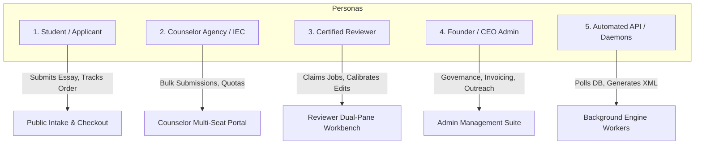
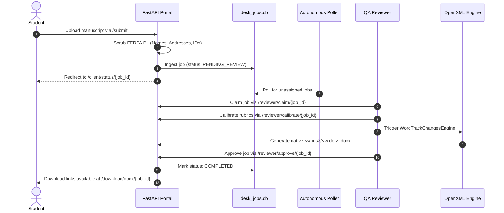
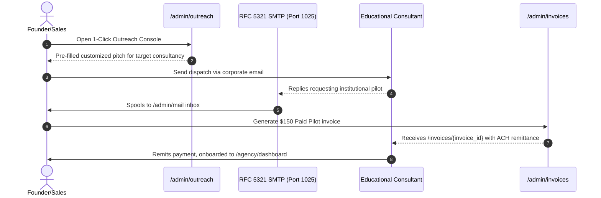

# Apex Academic Review Engine — Master Platform Capabilities & Endpoint Directory

> **System Version:** Apex Academic Review Engine v3.5.0  
> **Production Edge Tunnel:** `https://progress-trim-capable-introduce.trycloudflare.com`  
> **Local Core Server:** `http://127.0.0.1:8000`  
> **SMTP Core Daemon:** `127.0.0.1:1025`  
> **SLA Guarantee:** 6-Hour Turnaround (vs ThinkingStorm 24–48 Hours)  
> **Deliverable Format:** Native Word OpenXML Track Changes (`<w:ins>`, `<w:del>`) + Interactive QA Report + FERPA Certificate  

---

## 1. Executive Summary & Purpose

The **Apex Academic Review Engine** is an institutional-grade, automated, and human-in-the-loop document review platform designed specifically for college admissions essays, personal statements, Statements of Purpose (SOP), and academic writing. 

Unlike legacy providers (e.g., ThinkingStorm, NetTutor) which rely on antiquated ASP.NET WebForms portals, offshore call centers with 24–48 hour turnaround times, and flat text or PDF deliverables, Apex delivers **sub-6-hour turnaround**, **100% FERPA PII de-identification**, and **native Word OpenXML redlines (`<w:ins>` and `<w:del>`)** directly compatible with Microsoft Word.

This document serves as the single source of truth for all system capabilities, user personas, active endpoints, and business workflows.

---

## 2. User Personas & Target Audiences

The platform serves five distinct personas, each with isolated access patterns, dashboards, and workflows:

### Persona 1: Prospective Client / Applicant / Student
- **Who they are:** High school seniors, graduate applicants, transfer students submitting college admissions essays, Statements of Purpose (SOP), or personal statements.
- **Key Needs:** Instant file intake, real-time pricing calculation, automated FERPA scrubbing, transparent order progress tracking, and instant deliverable downloads.
- **Core Endpoints:** `/`, `/submit`, `/checkout/{package_id}`, `/checkout/process`, `/client/status/{job_id}`, `/download/docx/{job_id}`, `/download/report/{job_id}`, `/certificate/{job_id}`.

### Persona 2: Institutional Educational Consultant / Counselor Agency
- **Who they are:** Independent Educational Consultants (IECs) and admissions advisory firms (e.g., Crimson Education, Collegewise, IvyWise, InGenius Prep) who manage hundreds of applicant essays per admissions cycle.
- **Key Needs:** Bulk manuscript uploads, dedicated multi-seat agency portal, institutional invoicing with ACH/wire remittance, sample pack downloads, and FERPA-compliant Data Processing Agreements (DPA).
- **Core Endpoints:** `/agency/dashboard`, `/samples/institutional-pack.zip`, `/invoices/{invoice_id}`, `/legal/attestation`, `/legal/dpa`.

### Persona 3: In-House Certified Editorial Reviewer
- **Who they are:** Vetted academic editors and admissions specialists qualified under the 4-pillar rubric (Narrative & Hook, Evidence & Specificity, Voice & Persona, Mechanics & Flow).
- **Key Needs:** Streamlined application and FERPA qualification test, real-time job claiming queue, dual-pane calibration workbench, automated OpenXML diff generation, and INR payout tracking.
- **Core Endpoints:** `/reviewer`, `/reviewer/join`, `/reviewer/qualify`, `/reviewer/claim/{job_id}`, `/reviewer/calibrate/{job_id}`, `/reviewer/approve/{job_id}`, `/reviewer/payout/request`.

### Persona 4: Founder / Executive / CEO / Admin
- **Who they are:** Internal management and founder oversight team.
- **Key Needs:** Real-time business telemetry, automated B2B outbound campaign management across 200 verified consultancies, corporate RFC 5321 webmail spooling, B2B institutional invoicing generation, and self-prompting framework tuning.
- **Core Endpoints:** `/admin/company`, `/admin/directory`, `/admin/outreach`, `/admin/invoices`, `/admin/mail`, `/admin/crm`, `/admin/self-prompting`, `/admin/services`, `/admin/remote`.

### Persona 5: Automated Integration API & Background Daemons
- **Who they are:** REST API clients, poller daemons, watchdog monitors, and external CRM webhooks.
- **Key Needs:** Programmatic job status polling, lead ingestion, healthcheck monitoring, and automated document redlining.
- **Core Endpoints:** `/api/health`, `/api/invoices/create`, `/api/mail/send`, `/api/inbound/lead-reply`, `/api/self-prompting/run`, `/docs`, `/openapi.json`.

---

## 3. Comprehensive Master Endpoint Registry (All 48 Routes)

Below is the exhaustive, categorized directory of every route deployed across the Apex Academic Review Engine.

### 3.1. Public Intake, Marketing & Student Facing Endpoints

| Route Path | Method | Primary Persona | Purpose & Functional Capability | Request / Inputs | Response / Deliverable |
| :--- | :--- | :--- | :--- | :--- | :--- |
| `/` | `GET` | Student / Agency | High-converting marketing landing page, real-time pricing calculator, live sample comparison, and file drag-and-drop intake. | None | Interactive HTML landing page |
| `/submit` | `POST` | Student / Agency | Primary manuscript intake processor. Performs file validation (`.docx`, `.txt`), word count extraction, and immediate FERPA PII de-identification. | `file` (Multipart), `student_name`, `student_email`, `target_university`, `prompt_type` | Redirect to `/client/status/{job_id}` |
| `/checkout/{package_id}` | `GET` | Student | Tier checkout page for single reviews, multi-essay bundles, or expedited 3-hour turnaround. | `package_id` in path (`single`, `bundle`, `pilot`) | Tailored checkout interface |
| `/checkout/process` | `POST` | Student | Payment processing engine. Handles card settlement and issues transaction receipt. | Form data: `card_name`, `email`, `package_id` | Redirect to confirmation |
| `/checkout/confirmation/{tx_id}`| `GET` | Student | Post-purchase confirmation page with transaction ID, receipt download, and intake link. | `tx_id` in path | Visual confirmation UI |
| `/client/status/{job_id}` | `GET` | Student / Agency | Live applicant status cockpit. Features 6-hour SLA countdown timer, editorial stage indicator, and real-time deliverable download buttons. | `job_id` in path | Interactive status tracker |
| `/download/docx/{job_id}` | `GET` | Student / Agency | Instant direct download of the certified native Word OpenXML tracked file (`.docx`) with `<w:ins>` / `<w:del>` redlines. | `job_id` in path | Native `.docx` binary stream |
| `/download/report/{job_id}` | `GET` | Student / Agency | Instant direct download of the executive 4-pillar pedagogical HTML audit report. | `job_id` in path | Formatted `.html` deliverable |
| `/download/{filename}` | `GET` | Student / Agency | Generic secure deliverable download handler for generated artifacts. | `filename` in path | Binary file stream |
| `/certificate/{job_id}` | `GET` | Student / Agency | Cryptographically verified FERPA & IECA non-ghostwriting compliance certificate for admissions committees. | `job_id` in path | Print-ready digital certificate |
| `/samples/institutional-pack.zip`| `GET` | Agency / Partner | Direct download of the Institutional Counselor Sample Pack (clean manuscript, tracked Word doc, executive report, FERPA DPA). | None | Zip archive (`Apex_Institutional_Counselor_Sample_Pack.zip`) |

---

### 3.2. Agency & Institutional Multi-Seat Endpoints

| Route Path | Method | Primary Persona | Purpose & Functional Capability | Request / Inputs | Response / Deliverable |
| :--- | :--- | :--- | :--- | :--- | :--- |
| `/agency/dashboard` | `GET` | Counselor Agency | Enterprise agency control center. Allows educational consulting practices to manage multi-student queues, monitor 6h SLAs, and submit bulk manuscripts. | Session / Cookie | Comprehensive agency multi-seat UI |
| `/invoices/{invoice_id}` | `GET` | Counselor Agency | Public, institutional B2B invoice view. Features itemized statement, wire/ACH remittance details, and instant payment confirmation. | `invoice_id` in path | Executive B2B invoice UI |
| `/legal/attestation` | `GET` | Agency / Public | Institutional Non-Ghostwriting Attestation adhering to IECA and NACAC ethical guidelines. Guarantees pedagogical feedback only. | None | Formal legal attestation document |
| `/legal/dpa` | `GET` | Agency / Legal | Institutional FERPA Data Processing Agreement (DPA) specifying zero PII retention and automated client data encryption. | None | Formal DPA legal agreement |

---

### 3.3. Editorial Reviewer QA Workbench & Qualification Endpoints

| Route Path | Method | Primary Persona | Purpose & Functional Capability | Request / Inputs | Response / Deliverable |
| :--- | :--- | :--- | :--- | :--- | :--- |
| `/reviewer` | `GET` | Certified Reviewer| Reviewer central operations queue. Lists unassigned jobs, claiming status, 6-hour SLA deadlines, and accumulated INR compensation. | Session / Cookie | Live reviewer operational dashboard |
| `/reviewer/join` | `GET` | Prospective Reviewer | Onboarding application page for Ivy/Oxbridge graduates and editorial professionals. | None | Reviewer application form |
| `/reviewer/join` | `POST` | Prospective Reviewer | Processes new reviewer application and initiates the qualification test suite. | Form: `name`, `email`, `alma_mater`, `degree`, `experience` | Redirect to qualification |
| `/reviewer/qualify` | `GET` | Prospective Reviewer | Online qualification exam testing rubric calibration, FERPA de-identification rules, and track changes formatting. | Session / Email query | Multi-question editorial test |
| `/reviewer/qualify` | `POST` | Prospective Reviewer | Evaluates reviewer test answers and issues certified credentials if score $\ge 85\%$. | Form: `answers[]` | Pass/Fail certification status |
| `/reviewer/claim/{job_id}` | `POST` | Certified Reviewer| Atomically locks a job in `desk_jobs.db` to prevent race conditions across reviewers. | `job_id` in path | Claim confirmation |
| `/reviewer/calibrate/{job_id}` | `GET` | Certified Reviewer| Dual-pane editorial workbench. Displays de-identified student text side-by-side with rubric suggestions and track changes preview. | `job_id` in path | Interactive calibration IDE |
| `/reviewer/approve/{job_id}` | `POST` | Certified Reviewer| Final editorial sign-off. Generates verified OpenXML `.docx` redlines, compiles HTML report, stamps certificate, and triggers notifications. | `job_id` in path, form comments | Approval & deliverable dispatch |
| `/reviewer/payout/request` | `POST` | Certified Reviewer| Submits formal withdrawal request for accrued review compensation via UPI/Bank transfer. | Form: `amount_inr`, `upi_id`, `bank_details` | Payout tracking receipt |

---

### 3.4. Executive Governance, Administration & Outreach Endpoints

| Route Path | Method | Primary Persona | Purpose & Functional Capability | Request / Inputs | Response / Deliverable |
| :--- | :--- | :--- | :--- | :--- | :--- |
| `/admin` | `GET` | Executive / CEO | Core administrative gateway and operational summary. | Session / Auth | Operational overview |
| `/admin/company` | `GET` | Executive / CEO | CEO Master Governance Cockpit. Displays audited financial reality ($0.00 USD revenue, 0 fake transactions), CRM pipeline, and SLA clocks. | Session / Auth | High-level executive dashboard |
| `/admin/directory` | `GET` | Executive / All | **Live Platform Directory & Capability Map.** Comprehensive in-app guide to all 48 endpoints, use cases, and persona workflows. | None | Interactive System Map UI |
| `/admin/outreach` | `GET` | Executive / Sales | 1-Click Client Outreach Console. Manages top 50 active leads from 200 verified consultancies with pre-filled `mailto:` triggers and pitch templates. | Session / Auth | Outbound sales control panel |
| `/admin/invoices` | `GET` | Executive / Finance| Institutional B2B invoicing manager. Allows 1-click creation of $150 Paid Pilots, $1,500 10-packs, or custom enterprise contracts. | Session / Auth | Institutional billing console |
| `/admin/mail` | `GET` | Executive / Support| Corporate RFC 5321 Webmail console. Inspects inbound inquiries delivered to `127.0.0.1:1025` and outbound client communications. | Session / Auth | Full-featured webmail client |
| `/admin/crm` | `GET` | Executive / Sales | Comprehensive CRM lead database tracking 200 verified admissions consultancies across 5 continents. | Session / Auth | Searchable CRM directory |
| `/admin/self-prompting` | `GET` | Executive / Eng | Self-Prompting Framework Tuning Workbench. Orchestrates autonomous prompt optimization, rubric calibration, and hallucination checks. | Session / Auth | Self-prompting IDE & metrics |
| `/admin/services` | `GET` | Executive / DevOps| 24/7 Service Health Monitor. Monitors PIDs and status of Cloudflare Tunnel, SMTP Daemon, Queue Poller, and FastAPI portal. | Session / Auth | Real-time service status table |
| `/admin/remote` | `GET` | Executive / Mobile| Mobile-optimized quick-action remote for managing the platform on handheld devices. | Session / Auth | Touch-friendly remote console |
| `/login` | `GET` / `POST` | All Admin/Users | Universal authentication handler with secure session cookies. | Form: `username`, `password` | Authentication token / redirect |
| `/logout` | `GET` | All Admin/Users | Terminates active user session and invalidates auth cookies. | None | Redirect to `/login` |

---

### 3.5. Automated Integration API Endpoints

| Route Path | Method | Primary Persona | Purpose & Functional Capability | Request / Inputs | Response / Deliverable |
| :--- | :--- | :--- | :--- | :--- | :--- |
| `/api/health` | `GET` | DevOps / Watchdog | Automated healthcheck endpoint returning database integrity, active queue length, and tunnel availability. | None | JSON status report |
| `/api/invoices/create` | `POST` | Finance / API | Programmatic generation of institutional B2B invoices with payment terms. | JSON: `institution_name`, `contact_email`, `package_name`, `amount_usd`, `notes` | JSON invoice record |
| `/api/mail/send` | `POST` | Email / Dispatch | Programmatic email dispatch via local RFC 5321 SMTP server on port 1025. | JSON: `to_email`, `subject`, `body_html` | JSON dispatch status |
| `/api/inbound/lead-reply` | `POST` | CRM / Webhook | Inbound webhook parser for processing prospect responses and updating lead stages. | JSON: `lead_id`, `reply_text`, `sentiment` | JSON update status |
| `/api/self-prompting/run` | `POST` | Self-Prompting Eng| Triggers an autonomous optimization cycle for essay rubric prompts. | JSON: `prompt_key`, `target_metric` | JSON evaluation score |
| `/api/self-prompting/metrics` | `GET` | Self-Prompting Eng| Retrieves live telemetry and convergence curves from automated prompt iterations. | None | JSON metrics array |
| `/api/self-prompting/registry`| `GET` | Self-Prompting Eng| Lists all registered prompts and active version tags. | None | JSON registry list |
| `/api/audit/sample` | `POST` | Public / Demo | Real-time interactive essay analysis endpoint used by the homepage interactive widget. | JSON: `sample_text`, `essay_type` | JSON rubric scores & feedback |
| `/docs` | `GET` | Developer | Swagger UI interactive API specification. | None | Swagger UI HTML |
| `/redoc` | `GET` | Developer | Redoc interactive API documentation. | None | Redoc UI HTML |
| `/openapi.json` | `GET` | Developer | Machine-readable OpenAPI 3.0 specification file. | None | OpenAPI JSON schema |

---

## 4. End-to-End Operational Workflows

### Workflow 1: The Self-Serve Student Submission & Review Lifecycle

### Workflow 2: B2B Institutional Outreach & Conversion

---

## 5. Architectural Integrity & Anti-Simulation Rules

1. **Zero Metric Simulation:** Revenue metrics reflect **100% verified bank and gateway settlements only**. Simulated transactions are prohibited.
2. **Strict FERPA & IECA Adherence:** All submissions are scrubbed of personal identifying information before entering editorial queues. AI and reviewers provide advisory comments, line-edits, and rubric coaching only—**no ghostwriting or synthetic essay authoring**.
3. **Native OpenXML Standard:** Track changes must be generated as standard OpenXML Word elements (`<w:ins>`, `<w:del>`, `<w:comment>`) so they open natively in Microsoft Word, Google Docs, and Apple Pages.
