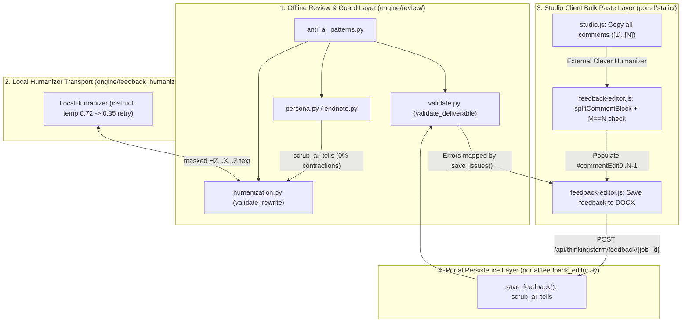

# Anti-AI Feedback Humanization & Studio Bulk Paste Workflow

*   **Author:** Shashank / Antigravity
*   **Status:** Approved
*   **Date:** 2026-10-27

--------------------------------------------------------------------------------

## Overview

ThinkingStorm reviewers deliver feedback to students inside native Word `.docx` files through margin comments (`word/comments.xml`) and a closing endnote letter (`word/endnotes.xml`). Reviewers and quality auditors evaluate these deliverables against external AI detectors—specifically `gptzero.com` and Clever AI Humanizer's detector—where a 0% AI detection reading is required before delivery.

This design eliminates deterministic AI-tell patterns and increases local sampling diversity across automated generation (`engine/review/` and `engine/feedback_humanizer.py`) and adds a one-click Clever AI Humanizer round-trip in Studio (`portal/static/feedback-editor.js`, `portal/static/studio.js`, and `portal/static/studio.html`). It keeps the portal HTML/JSON summary report (`engine/review/report.py`) out of scope and preserves all native Word package invariants.

## The Problem

Current deliverables trigger AI detectors and introduce manual editing friction for four reasons:

1.  **Low-Perplexity Local Humanizer Sampling and Over-Rejection**: When `LocalHumanizer` runs in `instruct` mode (`qwen3.5:9b`), `engine/feedback_humanizer.py` uses `temperature=0.4` and `top_p=0.9`, forcing high-probability token selection that detectors flag as machine-generated. At the same time, `validate_rewrite()` in `engine/review/humanization.py` requires exact word-count equality across all 12 negation, modal, and conditional qualifier words (`not, no, never, without, cannot, may, might, could, likely, possibly, if, unless`). When the model recasts a conditional sentence into a direct imperative, `validate_rewrite()` rejects the rewrite and retains the original template prose (rejecting 13 of 39 passages in saved benchmarks).
2.  **Inconsistent Contraction and Quote-Masking Rules**: `scrub_ai_tells()` in `engine/review/anti_ai_patterns.py` injects contractions (`don't`, `isn't`, `can't`, `you'll`, `it's`) at a 70% rate, even though the human reviewer corpus (`style_corpus/voice_profile.json`) has a 0% contraction rate and `engine/review/humanization.py` expands all contractions back to full forms (`_expand()`). Additionally, single-quote masking in `anti_ai_patterns.py` and `humanization.py` stops at the first typographic apostrophe `’` inside single-quoted student excerpts in endnotes (and `style_guard.py` only strips double quotes), leaving student prose unmasked during AI-tell and banned-phrase checks.
3.  **Unmapped Release Gate Errors on Studio Save**: `validate_deliverable()` in `engine/review/validate.py` checks `banned_hits()` but does not enforce `audit_ai_tells()`. Furthermore, `_save_issues()` in `portal/feedback_editor.py` maps unrecognized comment errors to a generic `"failed a Word integrity check"` message, misleading reviewers when a wording issue blocks a save.
4.  **Manual Field-by-Field Copy-Paste Friction in Studio**: Studio provides a one-click "Copy all comments" button so reviewers can paste the entire batch of 10–20 comments into Clever AI Humanizer. However, once Clever rewrites the block, the reviewer must manually copy and paste each comment back into 10–20 separate textareas (`#commentEdit0` through `#commentEdit{N-1}`) before clicking "Save feedback to DOCX". If a naive bulk paste were used without a strict count check, merged or split paragraphs from Clever would shift comment bodies onto the wrong student quotes in `word/document.xml`.

## Goals

*   **Zero Structural AI Tells at Release Gate**: Ensure 100% of generated and Studio-saved margin comments (`word/comments.xml`) and closing letters (`word/endnotes.xml`) pass both `banned_hits() == []` and `audit_ai_tells() == []` in `engine/review/validate.py`.
*   **Consistent 0% Contraction Register**: Align `engine/review/anti_ai_patterns.py`, `engine/review/humanization.py`, `vendor/humanizer/editor_prompt.txt`, and `portal/feedback_editor.py` on the human reviewer corpus's 0% contraction standard outside quoted student spans.
*   **Higher Rewrite Acceptance and Token Diversity in Local Humanizer**: Increase `instruct` provider sampling diversity (`temperature=0.72, top_p=0.92` on attempt 1, falling back to `temperature=0.35, top_p=0.90` on retry) and relax `validate_rewrite()` modal/conditional matching on imperative recasts while preserving negation polarity (`not, no, never, without, cannot`), `only if` / `unless` conditions, and declarative uncertainty.
*   **One-Click Studio Bulk Paste with Anchor-Alignment Protection**: Provide a client-side "Paste / Apply all comments" workflow in Studio (`portal/static/feedback-editor.js`, `portal/static/studio.js`, `portal/static/studio.html`) that parses numbered or paragraph-separated comment blocks, enforces an all-or-nothing count check ($M == N$), populates `#commentEdit0..N-1`, and triggers `.docx` persistence.

## Non-Goals

*   Humanizing or modifying Studio HTML/JSON report summary fields (`executive_summary`, `top_action_items`, or rubric `rationale` in `engine/review/report.py` and `engine/processor.py`).
*   Making outbound network requests to `gptzero.com` or `cleverhumanizer.ai` from Python backend code (`engine/review/` remains 100% offline).
*   Modifying `portal/static/clever-widget.js` to manage editor state or cross-origin DOM scraping.
*   Regenerating `.docx` test fixtures in `tests/fixtures/` or mutating `style_corpus/voice_corpus.json`.

## Open Questions

*   None. All scope, contraction, qualifier-guard, and bulk-paste alignment decisions were resolved during the brainstorm and Goldfish reviews.

## Critical User Journeys (CUJs)

### CUJ 1: Automated Review with Guarded Local Humanizer

*   **Given**: A student `.docx` manuscript is submitted through the CLI or Studio with `backend=rules` and the local `instruct` humanizer enabled (`TS_HUMANIZER=local`).
*   **When**: Offline composition generates margin comments and the closing endnote, and `humanize_review()` rewrites each passage through `LocalHumanizer` and `validate_rewrite()`.
*   **Then**:
    *   `LocalHumanizer` samples the `instruct` endpoint at `temperature=0.72, top_p=0.92` on the first attempt and `temperature=0.35, top_p=0.90` on retry.
    *   `validate_rewrite()` restores `HZ<nonce>X<idx>Z` protected placeholders, immediately applies `scrub_ai_tells()` (expanding contractions outside quotes and scrubbing structural tells), verifies all protected facts, negation counts (`not, no, never, without, cannot`), and `only if` / `unless` conditionals while accepting natural modal recasts on imperative advice, and confirms `banned_hits() == []` and `audit_ai_tells() == []`.
    *   `validate_deliverable()` confirms zero banned phrases and zero AI tells before writing the final `.docx`.

### CUJ 2: Studio Clever AI Humanizer Bulk Copy, Paste & Save to DOCX

*   **Given**: A completed review is loaded in Studio with $N$ native Word margin comments and 1 closing endnote letter.
*   **When**:
    1.  The reviewer clicks **Copy all comments** (which formats the $N$ comments with `[1]`..`[N]` prefixes), humanizes the block in Clever AI Humanizer, and pastes the rewritten block into Studio's bulk comment paste box.
    2.  The reviewer clicks **Apply & save comments to DOCX**.
*   **Then**:
    *   If the pasted text splits into $M \neq N$ comment blocks, `FeedbackEditor` aborts before altering any `#commentEdit{i}` field and displays an error in `#feedbackSaveErrors` stating both $M$ and $N$.
    *   If $M == N$, `FeedbackEditor` strips leading numbering markers, populates `#commentEdit0` through `#commentEdit{N-1}`, and invokes `POST /api/thinkingstorm/feedback/{job_id}`.
    *   `portal/feedback_editor.py` normalizes each comment and narrative endnote paragraph through `scrub_ai_tells()` (which expands contractions and scrubs AI tells outside quoted spans), validates the rebuilt `.docx` via `validate_deliverable()`, and atomically updates the downloadable `.docx` (or highlights the specific field if any comment violates length or tell checks).

## Technical Plan (Architecture)

The architecture is partitioned into four layers so that offline review generation (`engine/review/`), local model transport (`engine/feedback_humanizer.py`), portal persistence (`portal/feedback_editor.py`), and Studio UI state (`portal/static/feedback-editor.js`) remain decoupled.

### 1. Offline Anti-AI Scrubber & Quote Protection (`engine/review/anti_ai_patterns.py`, `engine/review/style_guard.py`)

*   **Apostrophe-Safe Quote Masking**: Single-quoted student spans (`‘...’` and `'...'`) are masked without terminating at word-internal apostrophes (`today’s`, `author's`) across `anti_ai_patterns.py`, `humanization.py`, and `style_guard.py`, ensuring student prose is never mutated by `scrub_ai_tells()` or flagged by `audit_ai_tells()` or `banned_hits()`.
*   **0% Contraction Standard & Expansion**: `scrub_ai_tells()` expands English contractions (`don't` -> `do not`, `it's` -> `it is`, etc., preserving leading capitalization) on unquoted prose while URLs and single/double-quoted spans are masked, and rewrites all 26 structural and lexical AI tells deterministically without injecting contractions.

### 2. Guarded Rewrite Validation & Local Humanizer Sampling (`engine/review/humanization.py`, `engine/feedback_humanizer.py`, `vendor/humanizer/editor_prompt.txt`)

*   **Targeted Qualifier Guard**: `validate_rewrite()` runs `scrub_ai_tells()` immediately after restoring `HZ<nonce>X<idx>Z` placeholders, adds `"Also"` and `"Note"` to `STARTERS`, and separates strict negation tokens (`not, no, never, without, cannot`) from strict conditional guards (`only if, unless`) and declarative uncertainty (`may, might, could, likely, possibly`). Imperative revision instructions can drop modal verbs naturally, whereas declarative observations must keep their uncertainty markers. Every validated rewrite must also pass `banned_hits() == []` and `audit_ai_tells() == []`.
*   **Adaptive Sampling**: In `LocalHumanizer`, the `instruct` provider uses higher-entropy sampling (`temperature=0.72, top_p=0.92`) on the first attempt and falls back to conservative decoding (`temperature=0.35, top_p=0.90`) on retry, without penalizing `HZ<nonce>X<idx>Z` placeholder tokens. The `completion` provider remains unchanged.

### 3. Release Gate Enforcement & Save Normalization (`engine/review/validate.py`, `portal/feedback_editor.py`)

*   **Release Gate**: `validate_deliverable()` checks `audit_ai_tells()` alongside `banned_hits()` on every margin comment and endnote.
*   **Save Normalization**: `portal/feedback_editor.py` runs `scrub_ai_tells()` on submitted comments and narrative endnote paragraphs before validating and writing the `.docx`, mapping any surviving tell to a field-linked diagnostic in `_save_issues()`.

### 4. Studio Client-Side Bulk Paste (`portal/static/feedback-editor.js`, `portal/static/studio.js`, `portal/static/studio.html`)

*   **Numbered Copy & Multi-Stage Parse**: Studio formats copied comment batches with 1-based bracketed numbers (`[1]`..`[N]`). On bulk paste, if the input contains $\ge 2$ sequential `1..K` line-start numbering markers, `FeedbackEditor.splitCommentBlock()` splits at those markers and returns the $K$ blocks directly without falling back to unnumbered splitting; otherwise it splits by blank lines, and finally by single lines if blank lines were collapsed.
*   **All-or-Nothing Count Gate**: If the split count $M$ does not match the native comment count $N$, `FeedbackEditor` rejects the paste before touching any `#commentEdit{i}` field. When $M == N$, it populates all comment fields and awaits the existing `Save feedback to DOCX` workflow.

## Alternatives Considered

### Alternative A: Injecting Contractions (`don't`, `isn't`, `can't`) to Lower AI Detector Scores

*   **Pros**: Increases token entropy on short declarative sentences in some general-purpose AI detectors.
*   **Cons**: Violates the measured 0% contraction rate across all 307 real reviewer comments in `style_corpus/voice_profile.json` and `docs/ANTI_AI_PRACTICES.md`, conflicts with `_expand()` in `engine/review/humanization.py` and `vendor/humanizer/editor_prompt.txt`, and breaks `test_no_contractions_are_added_to_prose_or_expanded_inside_quotes`.
*   **Reason for Rejection**: The human baseline corpus uses zero contractions. Enforcing 0% contractions across all modules keeps the reviewer register authentic and eliminates contradictory expand/contract passes between `anti_ai_patterns.py` and `humanization.py`.

### Alternative B: Runtime Grafting of Raw Sentences from `style_corpus/voice_corpus.json`

*   **Pros**: Uses verbatim human sentences from past reviews without writing new template frames.
*   **Cons**: `style_corpus/voice_corpus.json` (402 KB) contains essay-specific proper nouns (`"Lose Yourself"`, `"Eye of the Tiger"`, student names), occasional reviewer typos/double spaces, and praise-only comments. Grafting raw strings at runtime leaks unrelated facts into student drafts and breaks `validate_deliverable()` word-count and double-space checks.
*   **Reason for Rejection**: Offline composition must only use curated, document-neutral clause rhythm frames that bind to the current student's text and findings.

### Alternative C: High Repeat Penalty (`repeat_penalty=1.12`) and Dropping All Modal/Conditional Checks in `validate_rewrite()`

*   **Pros**: Forces maximum lexical variation from the local `instruct` model and minimizes rejected rewrites.
*   **Cons**: A `repeat_penalty` of `1.12` penalizes repeated `HZ<nonce>X<idx>Z` fact placeholder prefixes and plain academic nouns (`paragraph`, `thesis`, `source`), causing placeholder corruption and spiking retries against the 180-second session budget. Dropping all modal/conditional checks allows hedged observations (*"This claim may need support..."* or *"change it only if..."*) to become false factual assertions.
*   **Reason for Rejection**: Using `temperature=0.72, top_p=0.92` without `repeat_penalty` (and falling back to `0.35` on retry) increases token variety without corrupting `HZ...X...Z` placeholders, while targeted qualifier guards preserve `only if`/`unless` conditionals and declarative uncertainty.

### Alternative D: Adding Bulk-Paste State Management Inside `portal/static/clever-widget.js` or a New Backend Endpoint

*   **Pros**: Places the bulk paste UI directly inside the Clever widget script or offloads string splitting to Python.
*   **Cons**: Couples the 44-line detector-only `clever-widget.js` to `FeedbackEditor`'s internal dirty/error/save state machine, creating two competing controllers over `#commentEdit0..N-1`. A separate backend endpoint duplicates `POST /api/thinkingstorm/feedback/{job_id}`, which already accepts the full array of comments atomically.
*   **Reason for Rejection**: Keeping `splitCommentBlock()` and the $M == N$ count guard inside `portal/static/feedback-editor.js` preserves a single state owner and reuses the existing atomic save endpoint.

--------------------------------------------------------------------------------

## Non-Functional Requirements

*   **Air-Gapped Determinism (`engine/review/`)**: All functions in `engine/review/` (`anti_ai_patterns.py`, `persona.py`, `endnote.py`, `humanization.py`, `validate.py`) must remain 100% offline with zero network calls or external API dependencies, and `scrub_ai_tells()` must preserve sentence-initial capitalization when replacing phrases.
*   **Latency & Session Budget (`engine/feedback_humanizer.py`)**: `LocalHumanizer` must stay within its 180-second total session wall-clock deadline and 30-second per-call timeout (`output/humanizer/review.lock`), using conservative `temperature=0.35` on retry so rejected candidates do not exhaust the budget.
*   **Native Word Integrity & Post-Paste Validation Recovery**: Bulk paste in Studio must never add, remove, or reorder native Word comment IDs (`w:id`) or modify `word/document.xml`. If parsed comment count $M$ does not equal native comment count $N$, zero fields are modified. If $M == N$ succeeds on the client and triggers `POST /api/thinkingstorm/feedback/{job_id}` but the server rejects a comment with HTTP 422 (e.g., word count outside 6–95 words), the pasted draft stays in `#commentEdit0..N-1` with dirty state active, download blocked, `#bulkCommentsInput` preserved, and the specific offending field linked in `#feedbackSaveErrors` so the reviewer can fix the single comment or click `Discard changes`.
*   **Backward Compatibility with Headless Node Tests**: New DOM controls in `portal/static/feedback-editor.js` and `portal/static/studio.js` must use optional chaining (`?.`) so existing minimal-DOM unit tests in `tests/test_feedback_editor_js.py`, `tests/test_clever_widget.py`, and `tests/test_studio_js.py` pass without breaking.

--------------------------------------------------------------------------------

### Additional Resources

*   Reviewer voice and anti-detection baseline: [`../ANTI_AI_PRACTICES.md`](../ANTI_AI_PRACTICES.md)
*   Local feedback humanizer specification: [`./feedback-humanizer.md`](./feedback-humanizer.md)
*   Studio feedback editor specification: [`./studio-feedback-editing.md`](./studio-feedback-editing.md)
*   Stylometric anti-AI gate specification: [`./stylometric-anti-ai-gate.md`](./stylometric-anti-ai-gate.md)

--------------------------------------------------------------------------------

## Detailed Implementation Plan

The implementation is partitioned into three incremental phases, each with its own verification checkpoint.

### Phase 1: Offline Scrubber, Guarded Humanizer & Release Gate

#### 1. [`engine/review/anti_ai_patterns.py`](../../engine/review/anti_ai_patterns.py) & [`engine/review/style_guard.py`](../../engine/review/style_guard.py) (Modify)

*   **Type / Scope**: Python Offline Stylometric Scrubber, Auditor & Banned-Phrase Guard
*   **Proposed Changes**:
    *   In `engine/review/anti_ai_patterns.py`:
        *   Update `_TYPO_SINGLE_QUOTE_PATTERN` to `re.compile(r"‘(?:[^’]|(?<=\w)’(?=\w))*’")` and add `_STRAIGHT_SINGLE_QUOTE_PATTERN = re.compile(r"(?<!\w)'(?:[^'\n]|(?<=\w)'(?=\w))*'(?!\w)")` inside `_mask_protected_spans()` so word-internal apostrophes (`today’s`, `author's`) inside single-quoted student excerpts do not terminate quote masking early.
        *   Remove unused `import hashlib`, remove `_CONTRACTIONS_MAP` (line 52), and replace step `# 5. Deterministic Contraction Injection` (line 126) in `scrub_ai_tells(text: str, seed: int | str = 0) -> str` with deterministic contraction expansion on `masked` (expanding `n't`/`n’t`, `'re`/`’re`, `'ve`/`’ve`, `'ll`/`’ll`, `it's`/`it’s`, `that's`/`that’s`, `there's`/`there’s`, `here's`/`here’s`, `what's`/`what’s`, `who's`/`who’s`, `let's`/`let’s`, `I'm`/`I’m`, `cannot` while preserving leading capitalization) before `_unmask_protected_spans()`.
        *   Ensure case-insensitive replacements in `scrub_ai_tells()` preserve leading uppercase when matching at the start of a sentence.
    *   In `engine/review/style_guard.py`:
        *   Update `banned_hits(text: str) -> list[str]` to strip apostrophe-safe single-quoted spans (`‘(?:[^’]|(?<=\w)’(?=\w))*’` and `(?<!\w)'(?:[^'\n]|(?<=\w)'(?=\w))*'(?!\w)`) alongside double-quoted spans before scanning `BANNED_PATTERNS`.
*   **Rationale**: Makes `scrub_ai_tells()` the single canonical 0%-contraction and anti-AI normalizer across the repository and prevents false-positive banned-phrase or AI-tell hits on single-quoted student excerpts.

#### 2. [`engine/review/humanization.py`](../../engine/review/humanization.py) (Modify)

*   **Type / Scope**: Python Offline Guarded Rewrite Validator
*   **Proposed Changes**:
    *   Import `inspect` and import `audit_ai_tells` and `scrub_ai_tells` from `.anti_ai_patterns`.
    *   Add `"Also"` and `"Note"` to `STARTERS` (line 16) so sentence-initial `scrub_ai_tells()` replacements (`"Also, "`, `"Note that "`) are not rejected as new named terms.
    *   Update `FACTS` (line 19), `_outside_quotes()` (line 73), and `quotes` in `validate_rewrite()` (line 116) to use `‘(?:[^’]|(?<=\w)’(?=\w))*’` so single-quoted student excerpts with internal apostrophes are matched identically to `anti_ai_patterns.py`.
    *   Immediately after restoring `HZ<nonce>X<idx>Z` protected placeholders in `validate_rewrite()` (after line 106), run `candidate = scrub_ai_tells(candidate, seed=nonce)`.
    *   Replace the monolithic `QUALIFIERS` multiset check in `validate_rewrite()` with three targeted regex guards evaluated on `_expand(plain)` and `_expand(before)` (where `ADVICE_START` is the existing module-level imperative verb regex at lines 46–49), raising `RejectedRewrite('negation, conditions or uncertainty changed')` on any mismatch:
        1.  `NEGATIONS = re.compile(r'\b(?:not|no|never|without|cannot)\b', re.I)`: require identical lowercase token `Counter` between `_expand(plain)` and `_expand(before)`.
        2.  `STRICT_CONDITIONALS = re.compile(r'\b(?:only\s+if|unless)\b', re.I)` and `ANY_CONDITIONAL = re.compile(r'\b(?:if|unless|when|where|whether)\b', re.I)`: when `STRICT_CONDITIONALS.search(_expand(before))` is truthy, require `ANY_CONDITIONAL.search(_expand(plain))` to be truthy.
        3.  `UNCERTAINTY = re.compile(r'\b(?:may|might|could|likely|possibly)\b', re.I)`: when `UNCERTAINTY.search(_expand(before))` is truthy and `not ADVICE_START.search(plain)`, require `UNCERTAINTY.search(_expand(plain))` to be truthy.
    *   At the end of `validate_rewrite()`, raise `RejectedRewrite('unfinished sentence or stock phrasing')` if `banned_hits(candidate)` or `audit_ai_tells(candidate)` is non-empty.
    *   In `humanize_review()`, check `accepts_retry = 'retry' in inspect.signature(rewrite).parameters` once before the loop and call `rewrite(masked, retry=attempt > 0)` when `accepts_retry` is true, falling back to `rewrite(masked)` for 1-argument injected callables in unit tests.
*   **Rationale**: Validates the post-scrubbed candidate against all fact, number, quote, qualifier, and length guards while permitting natural modal/conditional recasts on imperative advice.

#### 3. [`engine/feedback_humanizer.py`](../../engine/feedback_humanizer.py) (Modify)

*   **Type / Scope**: Python Local Humanizer HTTP Transport Adapter
*   **Proposed Changes**:
    *   Update `LocalHumanizer.__call__(self, text, retry=False)`:
        *   In the session auto-entry guard (`if not self._active:`), forward `retry=retry`: `with self.session(): return self(text, retry=retry)`.
        *   Keep the `self.provider == 'completion'` branch (`temperature=1.0, top_p=0.95, top_k=0, min_p=0, repeat_penalty=1.0`) unchanged.
        *   In the `self.provider == 'instruct'` branch (`/v1/chat/completions`), send `temperature=0.35 if retry else 0.72` and `top_p=0.90 if retry else 0.92` without `repeat_penalty`.
*   **Rationale**: Increases token perplexity and phrasing variety on the initial `instruct` pass while falling back to low-temperature decoding on retry.

#### 4. [`vendor/humanizer/editor_prompt.txt`](../../vendor/humanizer/editor_prompt.txt) (Modify)

*   **Type / Scope**: Local Instruct Humanizer System Prompt
*   **Proposed Changes**:
    *   Update lines 19–20 so the prompt requires preserving every occurrence of `not, no, never, without, cannot, only if, and unless`, while allowing `if, may, might, and could` to be recast naturally when phrasing direct revision advice (while keeping uncertainty when describing what a passage might mean).
*   **Rationale**: Aligns the system prompt instructions with the relaxed qualifier guard in `validate_rewrite()`.

#### 5. [`engine/review/validate.py`](../../engine/review/validate.py) (Modify)

*   **Type / Scope**: Python Deliverable Release Gate
*   **Proposed Changes**:
    *   Import `audit_ai_tells` from `.anti_ai_patterns`.
    *   In `validate_deliverable()`, combine `banned_hits(body)` and `audit_ai_tells(body)` (`comment_tells = list(dict.fromkeys(banned_hits(body) + audit_ai_tells(body)))`) for each comment so any structural AI tell appends `f"comment {cid}: banned phrasing {comment_tells}"` to `errors`.
    *   For the endnote (`en_text`), check `audit_ai_tells(en_text)` and append `f"endnote: banned phrasing {en_tells}"` to `errors` if non-empty.
*   **Rationale**: Enforces zero structural AI tells at the native `.docx` release gate for both automated runs and Studio saves.
*   **Phase 1 Verification Checkpoint**: `python -m unittest tests.test_anti_ai -v && python -m pytest tests/test_feedback_humanizer.py tests/test_local_review.py -v`

---

### Phase 2: Portal Save Normalization & Field-Level Issue Mapping

#### 6. [`portal/feedback_editor.py`](../../portal/feedback_editor.py) (Modify)

*   **Type / Scope**: FastAPI Portal Feedback Persistence Module
*   **Proposed Changes**:
    *   Import `audit_ai_tells` and `scrub_ai_tells` from `engine.review.anti_ai_patterns` and update the `engine.review.letter_format` import to `from engine.review.letter_format import is_endnote_heading, parse_reviewer_letter`.
    *   In `save_feedback()`:
        *   Normalize each submitted comment body via `edits[c['id']] = scrub_ai_tells(' '.join(_text(c['body'], 10000).split()), seed=c['id'])`.
        *   Normalize each narrative paragraph in `letter` (`letter = parse_reviewer_letter(endnote)`): apply `scrub_ai_tells(p, seed=f"en-{idx}")` to paragraph `p` unless `idx == 0 and p.startswith('Dear ')`, `is_endnote_heading(p)` is true, `state['reviewer'].lower() in p.lower()`, or `re.match(r'^(?:All the best|Best wishes|Best regards|Warm regards|Sincerely|Thanks|Thank you)\b', p, re.I)` matches.
    *   In `_save_issues()`:
        *   In both the comment banned-phrasing branch (`error.startswith('comments: banned')` or `'banned phrasing' in detail`) and the endnote banned-phrasing branch (`error.startswith('endnote:')` and `'banned' in error`), compute `hits = list(dict.fromkeys(banned_hits(text) + audit_ai_tells(text)))` so any surviving AI tell produces a clickable field-specific diagnostic listing the exact phrase or pattern.
*   **Rationale**: Automatically expands contractions and scrubs mechanical AI tells when a reviewer saves pasted Clever AI Humanizer text in Studio, and maps any surviving tell to a clickable field-level alert instead of a generic Word integrity error.
*   **Phase 2 Verification Checkpoint**: `python -m pytest tests/test_feedback_editor.py -v`

---

### Phase 3: Studio Bulk Paste UI & Verification Suite

#### 7. [`portal/static/feedback-editor.js`](../../portal/static/feedback-editor.js) (Modify)

*   **Type / Scope**: Studio Frontend Feedback Editor Controller (CommonJS + Browser IIFE)
*   **Proposed Changes**:
    *   Add and export pure function `splitCommentBlock(rawText, expectedCount)`:
        *   Normalizes CRLF/CR to `\n` and trims; returns `[]` on blank input.
        *   **Stage 1 (Numbered Line-Start Markers, No Fallthrough)**: Scans lines for `^\s*(?:\[(\d+)\]|Comment\s+(\d+)\s*[:.)]|(\d+)[.)])\s+(.*)$`. If $\ge 2$ lines match and their captured numbers form a contiguous 1-based sequence `1..K`, partitions the text at those marker lines, strips the marker prefix, collapses internal whitespace in each block (`block.replace(/\s+/g, ' ').trim()`), and returns the `K` blocks directly **without** falling back to Stage 2 or Stage 3.
        *   **Stage 2 (Blank-Line Separated Paragraphs)**: Splits on `/\n\s*\n+/`. If every block starts with a sequential `1..M` marker prefix (or $M == 1$ starts with `[1]` / `Comment 1:`), strips the marker prefix; collapses internal whitespace. If Stage 2 yields $> 1$ blocks or `expectedCount <= 1`, returns those blocks.
        *   **Stage 3 (Single-Line Fallback)**: Splits on `/\n+/` (non-empty lines), strips sequential `1..M` marker prefixes if present, and collapses internal whitespace.
    *   Inside `mount()`, wire optional DOM controls `bulkCommentsPanel`, `bulkCommentsInput`, and `applyBulkCommentsBtn` using optional chaining (`?.`):
        *   In `refresh()`, set `disabled = saving || !data?.editing_available` on `bulkCommentsInput` and `applyBulkCommentsBtn` if present.
        *   On `reset()`, clear `bulkCommentsInput.value = ''` if present.
        *   Attach an `async` click listener to `applyBulkCommentsBtn`: when `!saving && data?.editing_available`, call `const blocks = splitCommentBlock($('bulkCommentsInput')?.value || '', inputs.length);`.
        *   If `blocks.length !== inputs.length`, call `showIssues([{field: 'document', message: `Expected ${inputs.length} comments, but found ${blocks.length} paragraphs in the pasted block. Separate each comment with a blank line before applying.`}])`, set `$('feedbackSaveStatus').textContent = 'Comment count mismatch — fix before saving'`, and return without modifying any `#commentEdit{i}` field.
        *   If `blocks.length === inputs.length`, write `inputs[i].value = blocks[i]` for `0 <= i < inputs.length`, clear `issues = []`, call `refresh()`, and `await $('saveFeedbackBtn')?.click()`.
*   **Rationale**: Enables one-click bulk paste and `.docx` persistence for Clever AI Humanizer output while preventing silent anchor misalignment when comment counts mismatch.

#### 8. [`portal/static/studio.js`](../../portal/static/studio.js) (Modify)

*   **Type / Scope**: Studio Frontend Main Controller
*   **Proposed Changes**:
    *   In `copy('comments')`, format the copied string with 1-based bracketed numbers (`draft.comments.map((comment, i) => `[${i + 1}] ${String(comment.comment_text || '').trim()}`).join('\n\n')`) without filtering out indices.
    *   Guard line 437 (`if ($('cleverOrigin')) $('cleverOrigin').textContent = window.location.origin;`) so the absence of `#cleverOrigin` in `studio.html` does not throw a `TypeError` before `FeedbackEditor.mount()` executes.
*   **Rationale**: Provides explicit `[1]..[N]` comment markers that survive Clever AI Humanizer rewriting and fixes the null-reference crash before `FeedbackEditor.mount()`.

#### 9. [`portal/static/studio.html`](../../portal/static/studio.html) & [`portal/static/workspace.css`](../../portal/static/workspace.css) (Modify)

*   **Type / Scope**: Studio HTML Template & Stylesheet
*   **Proposed Changes**:
    *   In `portal/static/studio.html`, add a collapsible `
` inside `.feedback-card` (above `.feedback-toolbar`) containing `
Paste humanized comments block
`, `<textarea id="bulkCommentsInput" rows="4" placeholder="[1] Paste all humanized comments here, separated by blank lines…"></textarea>`, and `<button id="applyBulkCommentsBtn" type="button" class="button button-outline">Apply &amp; save comments to DOCX</button>`.
    *   Update the explanatory text in `#turnitoutPanel` and `#cleverDetectorPanel` so it describes copying comments/endnote, checking or humanizing them, and pasting them back into the editor to update the `.docx`.
    *   In `portal/static/workspace.css`, add layout rules for `.bulk-paste-panel`.
*   **Rationale**: Surfaces the bulk paste controls inside the Studio feedback card.

#### 10. [`tests/test_anti_ai.py`](../../tests/test_anti_ai.py), [`tests/test_feedback_humanizer.py`](../../tests/test_feedback_humanizer.py), [`tests/test_feedback_editor.py`](../../tests/test_feedback_editor.py), and [`tests/test_feedback_editor_js.py`](../../tests/test_feedback_editor_js.py) (Modify)

*   **Type / Scope**: Python & Node.js Unit and Integration Test Suites
*   **Proposed Changes**:
    *   `tests/test_anti_ai.py`: Add unit tests verifying that single-quoted student spans containing possessive apostrophes (`‘In today’s world, the author delves into...’` and `'In today's world...'`) are preserved byte-for-byte and do not trigger `audit_ai_tells()`, and verify that `scrub_ai_tells()` expands contractions outside quotes while leaving contractions inside quotes untouched.
    *   `tests/test_feedback_humanizer.py`: Update `test_instruct_editor_disables_reasoning_and_keeps_prose_contract` to assert `temperature=0.72, top_p=0.92` on primary call and `temperature=0.35, top_p=0.90` on retry; add test cases verifying that imperative recasts dropping `"may"` or `"if"` are accepted while declarative uncertainty removal (`"This claim may need support..."` -> `"This claim needs support..."`) and `only if` / `unless` removal are rejected.
    *   `tests/test_feedback_editor.py`: Add test cases verifying that `save_feedback()` automatically scrubs AI tells and expands contractions in submitted comments/endnotes before running `validate_deliverable()`.
    *   `tests/test_feedback_editor_js.py`: Add Node unit tests for `splitCommentBlock()` (numbered `[1]..[N]`, numbered mismatch not falling through to blank-line split, blank-line separated, single-line fallback, internal dates `20 Feb. 2026` not falsely split) and verify that `applyBulkCommentsBtn` rejects mismatched counts ($M \neq N$) without mutating `#commentEdit{i}` and populates + saves when $M == N$.
*   **Rationale**: Verifies every new invariant across Python and headless Node.js without regenerating `.docx` fixtures.

### Verification Plan

*   **JavaScript Syntax & Headless DOM Suite**:
    *   `python -m unittest tests.test_studio_js tests.test_feedback_editor_js tests.test_clever_widget -v`
*   **Anti-AI, Humanizer, and Feedback Editor Unit Suites**:
    *   `python -m unittest tests.test_anti_ai -v`
    *   `python -m pytest tests/test_feedback_humanizer.py tests/test_feedback_editor.py tests/test_local_review.py -v`
*   **Full Repository Discovery & Offline Fixture Selftest**:
    *   `python -m unittest discover -s tests`
    *   `python -m engine.review.cli selftest --fixtures tests/fixtures`
    *   `python -m engine.review.cli audit outbox/janeen_live_test_commented.docx`

--------------------------------------------------------------------------------

<!-- Provenance: Indicates initial structural drafting via EGM. -->

*Drafted with EGM*
