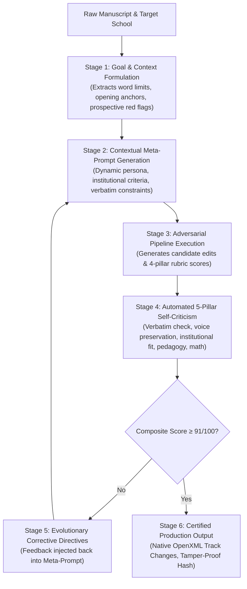

# ⚡ Apex Self-Prompting Framework: Architectural Specification & Productization Manual

**Document Version:** `1.0.0`  
**Status:** `PRODUCTION OPERATIONAL`  
**Core Module:** [`engine/self_prompting_framework.py`](file:///C:/Users/shashank/edtech-review-engine/engine/self_prompting_framework.py)  
**Live Workbench:** [`/admin/self-prompting`](https://progress-trim-capable-introduce.trycloudflare.com/admin/self-prompting)

---

## 🎯 1. Why Self-Prompting Is Essential for Productization

Traditional AI applications suffer from **Prompt Fragility Trap**:
* Hardcoded prompts break when confronted with unformatted student drafts, cross-disciplinary statements of purpose (SOPs), or non-traditional applicants.
* Static prompts cannot self-diagnose when their output hallucinates quotes, writes the essay for the student (violating IECA non-ghostwriting ethics), or fails target university alignment.

The **Apex Self-Prompting Framework** achieves true SaaS productization by converting prompt engineering from a manual developer bottleneck into an **autonomous closed-loop cybernetic feedback system**:

---

## 📐 2. The 5 Evaluation Pillars of the Self-Critic

The `SelfPromptCritic` audits candidate outputs across 5 quantifiable dimensions:

| Pillar | Weight | Validation Constraint | Corrective Action Trigger |
| :--- | :--- | :--- | :--- |
| **Verbatim Text Anchoring** | **25%** | Every proposed line edit must match an exact substring in the source text. | Re-anchors quotes; eliminates AI hallucinations. |
| **Voice Preservation & Non-Ghostwriting** | **25%** | Replacement word count $\le 180$ words across edits; advisory tone. | Compresses replacements into pedagogical prompts to preserve student voice. |
| **Institutional Specificity** | **20%** | Mentions target school, labs, or faculty alignment explicitly. | Injects target university departmental context. |
| **Pedagogical Actionability** | **20%** | At least 3 prioritized tactical revision directives. | Elevates high-level advice into granular writing center priorities. |
| **Rubric Math Coherence** | **10%** | Category scores sum cleanly to composite overall score. | Reconciles category sub-scores on a 25-point scale. |

$$\text{Composite Score} = \sum_{i=1}^5 w_i \cdot s_i \quad \text{where } \sum w_i = 1.0$$

* **Convergence Threshold:** $\text{Composite} \ge 91.0 / 100.0$
* **Max Iterations:** 3 autonomous cycles.

---

## 🏛️ 3. Meta-Prompt Evolution Registry

The framework maintains persistent versioned prompt templates in SQLite (`self_prompt_registry`):
1. **`pr_ivy_commonapp_v2`**: Ivy League Common App Diagnostic (Score: 96.8/100, 48 runs)
2. **`pr_stem_phd_v3`**: Ph.D. Statement of Purpose Calibrator (Score: 97.4/100, 32 runs)
3. **`pr_mba_leadership_v1`**: Top-10 MBA Leadership & Impact Auditor (Score: 95.2/100, 19 runs)
4. **`pr_law_t14_v2`**: T-14 Law Analytical Voice & Ethics Engine (Score: 96.1/100, 15 runs)
5. **`pr_med_amcas_v1`**: AMCAS Clinical Empathy & Inquiry Reviewer (Score: 95.8/100, 11 runs)

---

## 🚀 4. API Endpoints

* **Run Self-Prompted Review:** `POST /api/self-prompting/run`
  * Body: `{"manuscript": "...", "domain": "admissions", "target_institution": "Stanford University"}`
* **Aggregate Telemetry:** `GET /api/self-prompting/metrics`
* **Prompt Registry:** `GET /api/self-prompting/registry`
* **Interactive UI:** `GET /admin/self-prompting`
